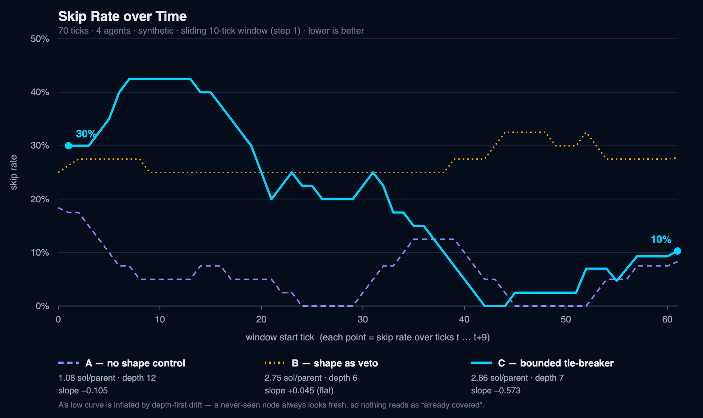

# delib-research

Research with the **MIT Center for Collective Intelligence** on user modeling and a multi-agent
recommendation system for **AIdeator**, a structured deliberation forum that helps groups
synthesize solutions within a set framework.

Before deploying anything on AIdeator, this repo uses an **agentic simulation**: LLM-driven
"industry professional" agents deliberate on a mission, and the recommender tries to learn what
each one will engage with. We measure how well it infers each agent's preferences and how fast
the rate of skipped recommendations falls.

> **Status:** active research code. Results below are from single runs; multi-seed replication
> is in progress. See [Limitations](#limitations).

## How it works

```
 Recommender ──picks (post, action)──▶ Agent ──engages / skips──▶ Clickstream
      ▲                                                               │
      └────── decision-tree user model, retrained from clickstream ◀──┘
```

- **Deliberation map.** A tree of posts (mission → stakeholders → goals → barriers → causes →
  solutions, plus analogies, questions, pros/cons, parts, failure modes), following the AIdeator
  methodology.
- **Agents.** 8 specialist personas (economist, engineer, policy maker, innovator, sociologist,
  environmentalist, psychologist, strategist), plus a facilitator and a synthesizer. All run on
  Gemini 2.5 Flash.
- **Two agent modes.**
  - `llm`: the agent decides freely via an LLM call (realistic, but noisy).
  - `synthetic`: a hidden ground-truth persona model decides deterministically
    (`engage ⟺` the post is closer to the agent's liked topics than disliked ones). This gives a
    clean answer key for measuring inference accuracy.
- **Recommender strategies.** `random`, `priority`, `multi_agent` (profile analyst + content
  selector + a per-agent decision tree trained online on 3072-d post embeddings), or `ab_rotate`
  to compare them in one run.
- **Shape control.** A bounded tie-breaker keeps the map broad and shallow without overriding
  the learned preference signal.

## Quickstart

**Prerequisites:** Python 3.11+, Node 20+, a [Gemini API key](https://aistudio.google.com/apikey).

```bash
git clone https://github.com/vihaankrishna100/delib-research.git
cd delib-research

# backend
cd backend
python3 -m venv venv && source venv/bin/activate
pip install -r requirements.txt
cp .env.example .env        # then paste your GOOGLE_API_KEY into .env

# frontend
cd ../frontend && npm install && cd ..

# run both
./start.sh
```

| Service  | URL                          |
|----------|------------------------------|
| Frontend | http://localhost:3001        |
| API      | http://localhost:8001        |
| API docs | http://localhost:8001/docs   |

The SQLite database and the agent roster are created automatically on first start.

> **Cost warning:** every simulation tick makes several Gemini calls per agent. A 50-tick,
> 6-agent run is on the order of a thousand calls. Start with a short run (10-20 ticks, 3-4 agents).

## Running a simulation

1. Open **http://localhost:3001/simulation**, enter a mission, and create a session.
2. Pick settings: number of ticks, `agent_mode`, recommendation strategy, `agent_sample_size`
   (use fewer agents to save time and money).
3. Start the session. Watch the map grow on the home page.
4. Explore results:
   - `/analytics`: skip-rate timeline, learned decision tree, strategy comparison
   - `/user-models`: per-agent topic trees, research metrics, action reports

Or drive it from the API:

```bash
curl -X POST localhost:8001/simulation/sessions -H 'content-type: application/json' -d '{
  "mission_name": "Reduce urban heat",
  "mission_description": "Cities are getting hotter...",
  "config": {"recommendation_strategy": "multi_agent", "agent_mode": "synthetic",
             "num_ticks": 20, "agent_sample_size": 4}
}'
curl -X POST localhost:8001/simulation/sessions/<SESSION_ID>/start
curl localhost:8001/analytics/sessions/<SESSION_ID>/skip_rate_timeline
curl localhost:8001/analytics/sessions/<SESSION_ID>/inference_accuracy   # synthetic mode
```

## Repository layout

```
backend/
  main.py                 FastAPI app
  models.py, schemas.py   DB tables and API schemas
  seed.py                 the 8 specialist personas + facilitator + synthesizer
  routes/                 map, simulation, analytics endpoints
  simulation/
    engine.py             tick loop and orchestration
    recommender.py        recommendation strategies and scoring
    user_model_tree.py    decision-tree user model (train / predict / export)
    ground_truth.py       hidden persona model for synthetic agents
    roles/                specialist, facilitator, synthesizer agents
    prompts/              prompt templates (AIdeator-derived)
frontend/                 Next.js app (map view, simulation control, analytics, user models)
docs/                     reports, prompts, slides, paper draft (see below)
```

## Documentation

| Doc | What's in it |
|-----|--------------|
| [docs/FINAL_REPORT.md](docs/FINAL_REPORT.md) | Methodology, results, and limitations |
| [docs/AGENTS_AND_PROMPTS.md](docs/AGENTS_AND_PROMPTS.md) | Every LLM prompt, verbatim, with file locations |
| [docs/CHANGES_LOG.md](docs/CHANGES_LOG.md) | Running changelog of fixes and experiments |
| [docs/PROGRESS_UPDATE.md](docs/PROGRESS_UPDATE.md) | Verified progress notes |
| [docs/paper/PAPER1_DRAFT.md](docs/paper/PAPER1_DRAFT.md) | Working paper draft |
| [docs/SLIDESHOW_OUTLINE.md](docs/SLIDESHOW_OUTLINE.md), [docs/SPEAKER_SCRIPT.md](docs/SPEAKER_SCRIPT.md) | Presentation materials |

## Preliminary results

From a single 70-tick, 4-agent synthetic run (see the report for full detail and caveats):

- The population skip rate falls from about 30% to about 10% as the profiles sharpen, after an
  initial cold-start rise.
- Among profiles that learned a real decision boundary, the tree recovers about 86% of the
  agents' true engage/skip labels on all session posts. Some profiles collapse to a single leaf
  (a constant predictor); those are excluded from this figure.



## Limitations

- Results are single-seed; replication across seeds is pending.
- The agents are simulated. Nothing here is validated against real AIdeator users yet.
- LLM-judgment agents are inconsistent, which caps what any learner can recover; the synthetic
  mode exists to separate that noise from the recommender's own performance.
- The benchmark is sensitive to how hard the ground-truth boundary is set (`ENGAGE_MARGIN` in
  `ground_truth.py`); see the report.

## Contributing

Issues and PRs welcome. If you change recommender behavior, note it in
[docs/CHANGES_LOG.md](docs/CHANGES_LOG.md).
